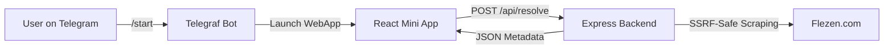

# Flezen Telegram Mini App & Bot 🚀

A Telegram Bot and Web Mini App built to preview, resolve, and display metadata for shared files from [Flezen](https://flezen.com).

Designed for seamless mobile integration within the Telegram desktop and mobile clients using the Telegram WebApp API.

---

## 📑 Table of Contents
- [Architecture Overview](#architecture-overview)
- [Features](#features)
- [Prerequisites](#prerequisites)
- [Quick Start Guide](#quick-start-guide)
  - [1. Install Dependencies](#1-install-dependencies)
  - [2. Create Telegram Bot](#2-create-telegram-bot)
  - [3. Configure Environment Variables](#3-configure-environment-variables)
  - [4. Local Development & Testing](#4-local-development--testing)
  - [5. Expose for Mobile Testing (HTTPS Tunnel)](#5-expose-for-mobile-testing-https-tunnel)
- [Production Deployment](#production-deployment)
- [Enabling Telegram Authentication](#enabling-telegram-authentication)
- [Integration Limitations & Playback/Download](#integration-limitations--playbackdownload)
- [Project Structure](#project-structure)
- [Available Scripts](#available-scripts)
- [Troubleshooting & FAQ](#troubleshooting--faq)

---

## Architecture Overview

The system consists of three modular components:
1. **Telegram Bot (`/bot`)**: Built with **Telegraf**. Responds to `/start`, provides the welcome screen, and surfaces the "Open Flezen" Web App button + persistent chat menu button.
2. **Backend API (`/backend`)**: Built with **Express**. Safely fetches and parses Flezen shared pages, validates SSRF security rules, enforces rate limits, validates Telegram `initData` signatures, and serves the static frontend assets.
3. **Telegram Mini App (`/frontend`)**: Built with **React** + **Vite**. Provides a mobile-responsive interface with dark/light theme support adhering to Telegram theme parameters (`window.Telegram.WebApp`), link input, metadata summary (filename, size, file type, views, upload date), and responsive action triggers.



---

## Features

- 🛡️ **SSRF-Protected Scraping**: Restricts outbound requests to allowlisted domains (`flezen.com`, `www.flezen.com`), prevents internal IP traversal via DNS pre-checks, limits response size, and caps redirects.
- 🔐 **Telegram HMAC Validation**: Cryptographically validates Telegram `initData` using the bot token secret key.
- 📱 **Telegram WebApp Integration**: Dynamic viewport expansion, haptic feedback hooks, theme-color matching, and Telegram native BackButton support.
- ⚡ **Lightweight & Fast**: Vite-powered client bundled into clean static assets directly served by Express.
- 🧪 **Comprehensive Automated Testing**: Unit and integration test suites across bot, backend, and frontend parsers.

---

## Prerequisites

- **Node.js**: v20 or newer (verify with `node -v`)
- **npm**: v9 or newer (verify with `npm -v`)
- A **Telegram account** (to register your bot via [@BotFather](https://t.me/BotFather))

---

## Quick Start Guide

### 1. Install Dependencies

Install dependencies across the root, bot, backend, and frontend:
```bash
npm run install:all
```

### 2. Create Telegram Bot

1. Open Telegram and search for [@BotFather](https://t.me/BotFather).
2. Send `/newbot` and follow the prompts:
   - Provide a friendly display name (e.g. `Flezen Downloader`).
   - Choose a username ending with `bot` (e.g. `MyFlezenBot`).
3. BotFather will provide an API token in the format `123456789:AAExxxxxxxxxxxxxxxxxxxxxxxx`.
   > [!IMPORTANT]
   > Keep your bot token secure. Never commit it to version control.

### 3. Configure Environment Variables

Create your environment configuration file:
```bash
# On Linux / macOS / Git Bash:
cp .env.example .env

# On Windows PowerShell:
Copy-Item .env.example .env
```

Open `.env` and fill in the values:
```env
BOT_TOKEN=123456789:AAExxxxxxxxxxxxxxxxxxxxxxxx
WEB_APP_URL=https://your-public-domain-or-tunnel.example.com
PORT=3000
ALLOWED_HOSTS=flezen.com,www.flezen.com
REQUIRE_TELEGRAM_AUTH=false
SERVE_FRONTEND=true
```

> [!NOTE]
> During local browser testing, keep `REQUIRE_TELEGRAM_AUTH=false`. Set it to `true` when testing live inside the Telegram app.

---

### 4. Local Development & Testing

#### Run Automated Test Suites
```bash
npm test
```

#### Build the Mini App
```bash
npm run build:frontend
```

#### Start the Server
```bash
npm start
```
Open [http://localhost:3000](http://localhost:3000) in your browser.
A yellow banner stating *"development mode: running outside Telegram"* is normal when opened in a standard web browser.

Test with a Flezen link:
```text
https://flezen.com/s/<share_id>
```

---

### 5. Expose for Mobile Testing (HTTPS Tunnel)

Telegram Web Apps **require** a valid `https://` address. Localhost URLs will not open in mobile Telegram apps.

You can create an instant HTTPS tunnel using Cloudflare or ngrok:

#### Option A: Cloudflare Tunnel (Free, no account needed)
```bash
npx cloudflared tunnel --url http://localhost:3000
```
Copy the generated URL (e.g. `https://xyz.trycloudflare.com`).

#### Option B: ngrok
```bash
ngrok http 3000
```
Copy the generated `https://` URL.

#### Update `.env` and Launch the Bot
1. Update `WEB_APP_URL` in `.env` with your tunnel URL:
   ```env
   WEB_APP_URL=https://xyz.trycloudflare.com
   ```
2. In a second terminal, start the bot:
   ```bash
   npm run start:bot
   ```
3. Open your bot on your phone or desktop in Telegram, type `/start`, and tap **Open Flezen**.

---

## Production Deployment

For continuous 24/7 uptime, deploy on a cloud host supporting Node.js (e.g. Render, Railway, Fly.io, DigitalOcean, or VPS).

You require **two processes**:
1. **Web Service (API + Mini App)**:
   - Build command: `npm run install:all && npm run build:frontend`
   - Start command: `npm start`
   - Port: Auto-assigned or `3000`
2. **Worker Service (Telegram Bot)**:
   - Start command: `npm run start:bot`

### Production Environment Variables
| Variable | Value / Description |
| :--- | :--- |
| `BOT_TOKEN` | Your Telegram Bot token from @BotFather |
| `WEB_APP_URL` | Public HTTPS domain of the Web Service |
| `PORT` | Listening port for Express (default: 3000) |
| `ALLOWED_HOSTS` | `flezen.com,www.flezen.com` |
| `REQUIRE_TELEGRAM_AUTH` | `true` (enforces Telegram session security) |
| `SERVE_FRONTEND` | `true` |

---

## Enabling Telegram Authentication

Once your app is successfully deployed and running inside Telegram:
1. Set `REQUIRE_TELEGRAM_AUTH=true` in `.env` / hosting settings.
2. Restart the web service.
3. Every request to `/api/resolve` must now contain the cryptographic `initData` provided by Telegram WebApp SDK. Browser requests directly to `/api/resolve` will be safely rejected with HTTP 401.

---

## Integration Limitations & Playback/Download

### Current Capabilities
- Resolves file name, file size (in bytes & formatted), file extension, content category (video/image/document), view count, and upload timestamp from public share links (`https://flezen.com/s/{id}`).
- Provides an immediate "Open in Flezen" action button to view the file in the official Flezen Android application.

### Why Direct Playback/Download is not built-in:
Flezen's share pages are designed to direct web visitors to the official Android app, without an exposed public media stream URL, direct download API, or iframe video player.

### Enabling Video Playback & Downloading
When official API keys or streaming endpoints are available:
1. Edit [`backend/src/providers/flezen/FlezenProvider.js`](file:///d:/desktop/Mini%20Projects/flezen%20bot/backend/src/providers/flezen/FlezenProvider.js):
   - Update `getPlaybackSource(resolved)` to return `{ available: true, url: streamUrl, mimeType: 'video/mp4' }`.
   - Update `getDownloadSource(resolved)` to return `{ available: true, url: downloadUrl }`.
2. The frontend already includes HTML5 video playback components and download triggers, and will display them automatically as soon as the backend flags them as available.

---

## Project Structure

```text
flezen-telegram-player/
├── .env.example              # Sample environment template
├── package.json              # Monorepo scripts
├── README.md                 # Complete documentation
├── NEXT_STEPS.txt            # Progress tracker and instructions
│
├── backend/                  # Express REST API
│   ├── src/
│   │   ├── app.js            # Express application setup
│   │   ├── config.js         # Environment config parser
│   │   ├── errors.js         # Centralized error mapping
│   │   ├── server.js         # HTTP server entry point
│   │   ├── providers/        # Provider abstraction & Flezen implementation
│   │   ├── routes/           # /api/resolve and /api/health routes
│   │   └── services/         # safeFetch (SSRF guard), telegramAuth validator
│   └── tests/                # Jest / Node test suites
│
├── bot/                      # Telegram Bot service (Telegraf)
│   ├── index.js              # Bot entry point
│   ├── createBot.js          # Bot instance factory
│   ├── messages.js           # Bot copy & text templates
│   └── handlers/             # Telegram command handlers (/start)
│
└── frontend/                 # Telegram Mini App (React + Vite)
    ├── src/
    │   ├── App.jsx           # App shell and page routing
    │   ├── main.jsx          # React DOM root
    │   ├── components/       # UI components (Header, Player, FileCard)
    │   ├── pages/            # Home & Result pages
    │   └── services/         # Telegram SDK wrapper & API client
    └── vite.config.js        # Vite bundler configuration
```

---

## Available Scripts

Run these from the root repository folder:

| Command | Description |
| :--- | :--- |
| `npm run install:all` | Installs dependencies for root, backend, frontend, and bot |
| `npm test` | Runs test suites across backend and bot |
| `npm run build:frontend` | Compiles the React Mini App into `frontend/dist` |
| `npm start` | Starts the Express backend server (serves API & Mini App) |
| `npm run start:bot` | Starts the Telegram Bot |
| `npm run dev:backend` | Starts the backend with file watching / auto-reload |
| `npm run dev:frontend` | Starts the Vite dev server with Hot Module Replacement |
| `npm run dev:bot` | Starts the bot in development mode |

---

## Troubleshooting & FAQ

#### Q: The Mini App screen is blank inside Telegram
- Ensure your `WEB_APP_URL` begins with `https://`. Telegram disallows plain `http://`.
- Run `npm run build:frontend` before starting the backend so `frontend/dist` is populated.

#### Q: Bot says "Cannot start bot: BOT_TOKEN is required"
- Verify `.env` exists in the project root and `BOT_TOKEN` is populated with your token from @BotFather.

#### Q: The Mini App says "Development mode: running outside Telegram"
- This message is expected if you open `http://localhost:3000` in standard desktop browsers (Chrome, Edge, Firefox). The warning disappears when launched inside Telegram.

#### Q: Requests fail with HTTP 401 Unauthorized
- If `REQUIRE_TELEGRAM_AUTH=true` is set, test requests made outside the Telegram mobile app will be rejected. Set `REQUIRE_TELEGRAM_AUTH=false` for local browser testing.

